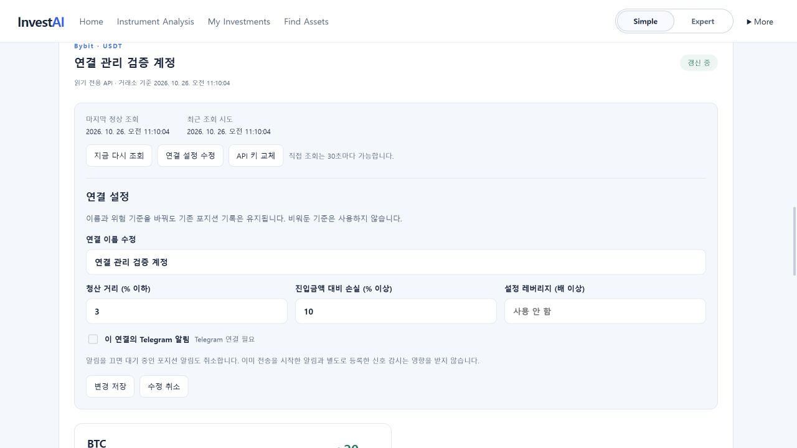
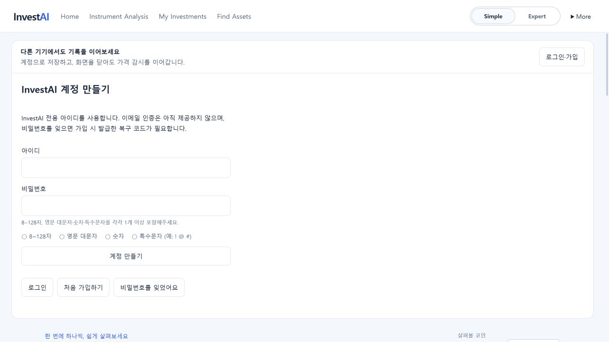

# 거래소 연결 관리와 가입 비밀번호 — 2026-10-26

## 사용 경로

시장·기록 → 포지션 연결에서 기존 연결 카드의 **지금 다시 조회 / 연결 설정 수정 / API 키 교체**를 사용한다. 심플 화면의 포지션 카드와 전문가 표는 유지하며 관리 기능을 공통으로 제공한다.

- 이름, 청산 거리·미실현 손실·설정 레버리지 기준, 해당 연결의 Telegram 발송 여부를 수정한다. 사용하지 않을 기준은 비운다. Lighter는 레버리지 기준을 지원하지 않는다.
- 즉시 재조회는 30초에 한 번 가능하며 진행 중인 같은 연결의 조회와 합친다. 마지막 정상 조회와 최근 조회 시도를 따로 표시한다. 오류가 나면 이전 포지션을 보존하고 위험 판정을 보류한다. 일시 정지한 연결은 먼저 갱신을 다시 시작해야 한다.
- Binance/Bybit의 새 키는 기존 읽기 전용 권한 검사와 포지션 조회를 모두 통과한 뒤 암호화해서 교체한다. 실패·중복 키·동시 수정이면 기존 키를 보존한다. 브라우저 저장소나 응답·내보내기에는 키를 넣지 않는다.
- 키 교체 전후 계정이 같다고 가정하지 않는다. 기존 관측 기록은 남기고 새 포지션을 기준으로 다시 시작한다. 이전 계정과 비교해 신규 진입/종료를 만들지 않으며, 연결된 반대 신호 감시는 종료한다. 일시 정지는 그대로 유지한다.
- 연결 설정에 버전을 부여해 다른 기기의 변경을 덮어쓰지 않는다. 변경 전 시작된 늦은 조회 결과도 적용하지 않는다. 기존 저장 형식의 버전 누락은 0으로 읽어 별도 자료 이전이 필요 없다.
- Telegram을 끄면 아직 발송을 시작하지 않은 해당 연결의 포지션 알림도 취소한다. 이미 전송 중인 알림과 별도 신호 감시는 별개다. 운영 봇 설정이 없다면 외부 알림을 켤 수 없다.
- InvestAI에서 키를 교체하거나 연결을 삭제해도 거래소에 발급된 API 키 자체를 폐기하지는 않는다.

실제 거래소 계정의 키·지역·IP 허용 설정에 따른 연결 성공 여부는 사용자의 조회 전용 키로 확인해야 한다. 개발 검증에는 가짜 응답과 격리된 검증 계정을 사용했으며 실제 주문·출금 기능은 없다.

## 비밀번호와 이메일

신규 가입 및 복구 코드로 비밀번호 재설정 시 **8~128자 + 영문 대문자 + 숫자 + ASCII 특수문자 각각 1개 이상**을 요구한다. 소문자는 별도 필수 조건이 아니다. 프런트 안내와 서버 검증은 같은 규칙을 사용한다. 기존 회원은 예전 비밀번호의 조합을 바꾸지 않아도 로그인할 수 있다. 로그인 제한·scrypt 해시·세션 폐기 규칙은 유지한다. PC 전용 API 키 보관함의 별도 비밀번호 정책은 변경하지 않는다.

이메일 인증은 이번 구현에 포함하지 않았다. 현재는 아이디와 비밀번호, 가입 시 발급한 일회용 복구 코드로 복구한다. 후속 회원 기능으로 이메일 등록/소유 확인, 인증 메일 재발송 제한, 이메일 변경 재인증, 만료·일회용 재설정 링크, 메일 발송 공급원 설정을 함께 구현할 예정이다. 아직 이메일로 복구할 수 있다고 안내하지 않는다.

## 검증

- 서버: 설정 보존·재시작, 잘못된 값, 다른 회원 접근, 오래된 설정 충돌, 조회 실패 보존, 재조회 제한, 새 키 권한 실패, 중복 키 보존, 키 암호화, 교체 중 이전 키 조회 응답 경합, 기존 비밀번호 로그인과 8자 가입/복구를 검사했다.
- 화면: 편집 값·버전 전송, 저장 성공/실패, 즉시 재조회, 동의 전 교체 차단과 실패 후 입력 비우기, 가입 조건 표시를 검사했다.
- 실제 브라우저에서 검증 계정의 연결 이름과 청산 거리 기준을 수정하고 재조회 결과를 확인했다. 아래 화면은 실제 금융 계정이 아닌 검증 자료다.
- 재현: `frontend`에서 `node tools/connection-preview.mjs`. 127.0.0.1:4194의 임시 저장소와 가짜 포지션 응답만 사용한다. 파일에 적힌 검증용 계정으로 로그인하며 외부 거래소나 Telegram에 검증 키를 보내지 않는다.

