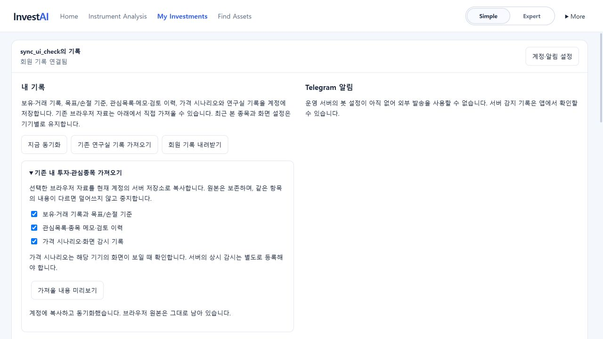

# 내 투자·관심종목 계정 동기화 — 2026-10-26

## 사용 흐름

로그인하면 해당 계정의 보유·거래 기록, 목표/손절 기준, 관심목록·메모·검토 이력과 가격 시나리오를 읽는다. 기존 비회원 자료는 원래 브라우저에 남으며 자동으로 업로드하지 않는다. 계정 설정에서 **기존 내 투자·관심종목 가져오기 → 항목 선택 → 미리보기 → 확인한 자료 복사** 순서로 합칠 수 있다.

- 같은 보유 기록 ID에 다른 내용이 있으면 가져오기를 중지한다. 수량을 더하거나 거래를 중복 생성하지 않는다.
- 관심목록의 종목은 합집합으로 가져온다. 같은 관심종목의 메모·검토 내용 또는 같은 목록 ID의 이름이 다르면 덮어쓰지 않는다.
- 미리보기 뒤 브라우저 자료, 계정 자료 또는 계정 자체가 바뀌면 다시 미리보기를 요구한다.
- 가져오기 전에 전체 선택 자료를 검증하고 전송 대기 사본을 먼저 보관한다. 각 자료 묶음의 서버 전송은 순차적이다. 일부 전송만 완료되면 완료로 안내하지 않고 나머지 대기·충돌을 표시한다.
- 로그아웃하면 기존 비회원 자료로 돌아온다. 계정이 바뀔 때 관심목록과 분석 화면의 상태도 새 계정으로 다시 만든다.

## 저장과 충돌

서버의 기존 회원 인증·버전 검사·SQLite 저장소를 사용한다. 보유 기록은 거래 원장을 포함한 한 묶음, 관심목록과 메모는 서로 분리되지 않는 한 묶음, 가격 시나리오와 변화 기록도 한 묶음으로 전송한다. 동시 편집은 묶음 단위 충돌로 남는다. 두 사본을 다운로드한 뒤 서버 사본 또는 현재 탭 사본을 선택할 수 있다. 자동 병합으로 수량·평단가·거래 원장을 바꾸지 않는다.

입력은 약 0.4초 후 전송하며, 다른 기기 변경은 약 20초마다 또는 화면 복귀/지금 동기화에서 확인한다. 즉시 동시 편집 서비스는 아니다. 전송 실패 시 계정별 탭 저장소에 대기 사본이 남고, 대기 자료가 있으면 로그아웃을 막고 창을 닫기 전에 경고한다. 저장 공간이 부족해 대기 사본을 만들지 못하면 입력 변경을 저장 성공으로 처리하지 않는다. 탭을 강제로 닫거나 브라우저 저장소를 지우면 미전송 자료를 잃을 수 있다.

서버 허용 크기는 보유 묶음 4MB, 관심목록 묶음 1MB, 시나리오 묶음 200KB이다. 보유 1,000개/거래 합계 10,000건, 관심목록 12개/검토 메타데이터 2,000종목, 시나리오 10개/활성 3개/변화 기록 60건의 기존 또는 명시적 한도도 적용한다. 브라우저의 탭 저장 공간에 따라 더 작은 자료도 전송 대기로 보관하지 못할 수 있으며 이 경우 원본을 유지한다.

## 범위

- 파일 백업은 현재 선택된 계정 또는 비회원 기록을 내려받는다. 로그인한 상태에서 복원을 확정하면 추가된 자료가 계정 서버에도 동기화된다.
- 최근 본 종목과 작성 중인 종목 분석 입력은 계정별·기기별로 분리하며 서버에 전송하지 않는다. 언어와 화면 설정도 기기별이다.
- 가격 시나리오와 그 기록의 동기화가 서버 상시 감시 등록을 대신하지 않는다. 기존 화면 감시는 탭이 보이는 동안만 동작하며, 여러 기기에서 동시에 관측하면 변경 충돌이 발생할 수 있다.
- 거래소의 실제 체결 내역을 자동으로 가져오거나 주문을 실행하지 않는다. 사용자가 입력한 거래 기록을 동기화한다.
- Telegram 운영 봇 활성화, 추가 거래소 검증, 자유 대화 AI와 외부 시장 데이터 공급원은 이 변경의 범위가 아니다.

## 검증

- 서버: 새 자료의 회원 격리·재시작 복원·버전 충돌·삭제 표식, 큰 거래 원장 전송, 잘못된 형식/초과 용량 차단을 포함해 102개 테스트 통과.
- 프런트: 원본 보존, 미리보기 이후 변경 차단, 거래 원장 이전, 삭제 유지, 계정 분리, 충돌 사본, 통신 실패 보관, 저장 공간 실패, 관심목록 원격 갱신과 재전송 방지를 검증.
- 전체 프런트 1,014개 테스트 통과 후, 작성 중인 분석 메모도 계정별로 분리하는 검사를 추가했다. 최종 변경은 CI에서 전체 검사한다.
- 실제 격리 브라우저: 비회원 BTC 보유 0.01개를 생성하고 명시적으로 가져온 후, 회원 자료를 0.02개로 변경해 별도 로그인 탭에서도 반영되는 것을 확인했다. 시험 자료이며 실제 보유·주문이 아니다.
- 타입 검사와 프로덕션 빌드, 프록시·AI 게이트웨이·Pages 포장 19개 검사 통과. lint는 기존 경고 3개만 유지.

